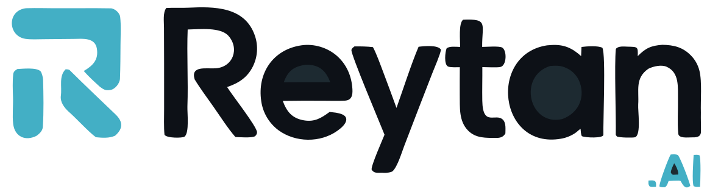
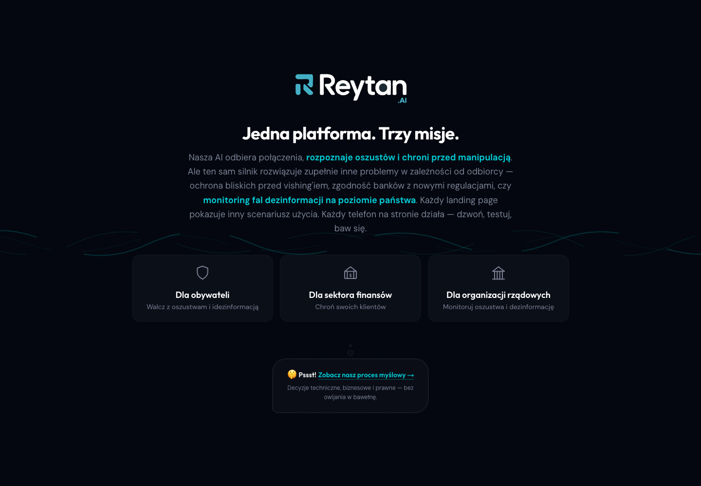
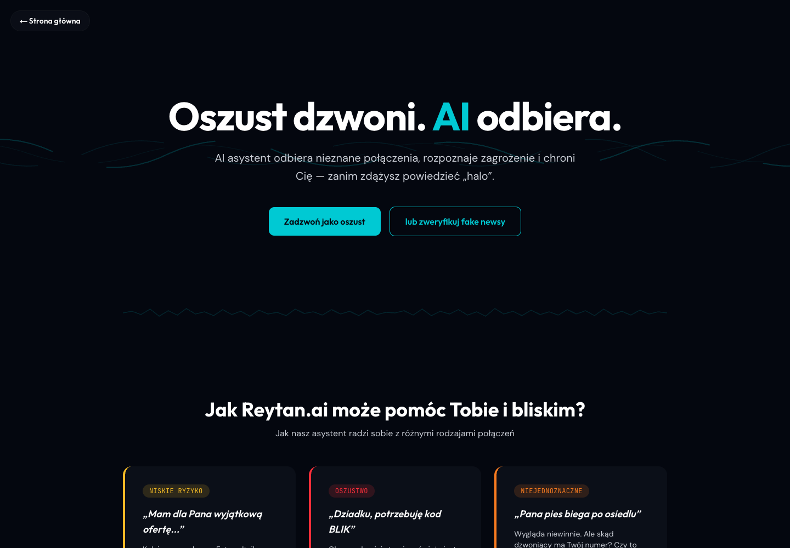
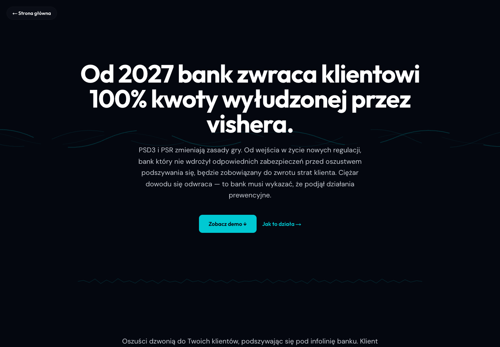
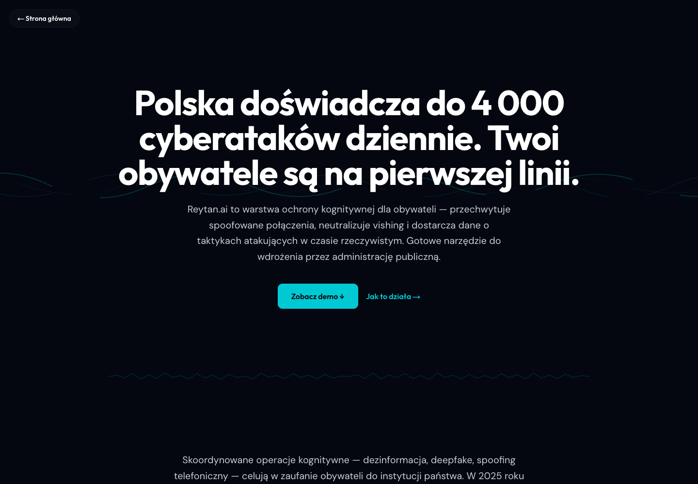
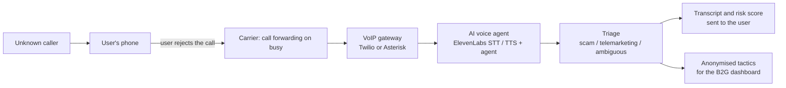
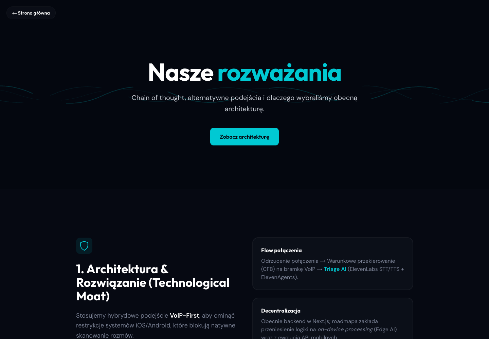

  <picture>
    <source media="(prefers-color-scheme: dark)" srcset="docs/logo-dark.svg">
    
  </picture>

<b>A scammer calls. An AI agent answers.</b> 
Case study of a 24-hour build at the Civil42 dual-use hackathon, Lublin, 11–12 April 2026.

---

## The problem

Voice scams ("vishing") are growing fast in Poland: fake bank hotlines, the "grandson who needs a BLIK code", spoofed caller IDs. Number blocklists do not help when the number is spoofed or new, and the people targeted most, older and less digital citizens, are the least able to spot a deepfaked voice.

Reytan.ai takes a third path between "ignore the call" and "risk the conversation": **you reject an unknown call, and an AI agent picks it up for you.** It talks to the caller, asks verifying questions, gives away nothing, classifies the call (telemarketing, scam, ambiguous) and sends you the transcript with a risk score.

## One engine, three products

The same call-triage engine serves three audiences, each with its own landing page:

| Audience | Value |
|---|---|
| **Citizens (B2C)** | A personal voice assistant that answers suspicious calls and protects relatives from scams. |
| **Banks (B2B)** | Under PSD3/PSR a bank refunds a customer scammed by someone impersonating the bank. Reytan is a protection layer the bank can distribute, paid for by the fraud losses it prevents. |
| **Government (B2G)** | Every blocked call is a honeypot: transcripts show scammers' tactics and disinformation waves in real time, without mass surveillance of citizens. |

| | |
|---|---|
|  |  |
|  |  |

## Architecture

iOS and Android do not let apps listen to phone calls, so on-device call scanning is not possible. We chose a **VoIP-first** design that needs no app permissions at all:

Key decisions (the full reasoning was published as part of the demo):

- **Fail-safe by design.** Only calls the user rejects reach the system. If the platform goes down, phones work exactly as before.
- **Pluggable telephony.** Twilio and Asterisk sit behind one interface, so the VoIP provider can change without touching the agent.
- **Privacy by design (GDPR).** No bulk data collection; the agent introduces itself as an AI assistant at the start of the call; Reytan acts as a technology provider (SaaS), not a party to the conversation.
- **Unit economics.** Call forwarding costs the carrier about 1.20–2.40 PLN per user per month. A high-end conversational model (ElevenLabs) for the MVP, with a planned move to cheaper LLM/TTS models at scale.
- **Roadmap.** Move the logic from the Next.js backend to on-device processing as mobile APIs open up.

## What we built in 24 hours

- Three landing pages and a page with our architectural, legal and business reasoning.
- A working demo: a phone simulator in the browser where a visitor plays the scammer and talks live to the AI agent, which classifies the call.
- A "check a fake news" mode backed by a separate analysis prompt.
- A verification panel and a dispatcher dashboard for the government scenario.
- Twilio and Asterisk adapters for the real VoIP path.
- Deployed and running live for the jury.

**Stack:** TypeScript monorepo (npm workspaces), Next.js 16 (App Router), React 19, Tailwind CSS 4, NestJS 11, TypeORM, PostgreSQL, Zod, ElevenLabs SDK, Twilio / Asterisk, Docker Compose, dev containers.

## Team and my role

A team of five:

- **Przemysław Gołec (me):** architecture and AI logic, infrastructure, technical ownership of the whole build so it ran live. I set up the monorepo, Docker and dev containers and the deployment; wrote the triage and fake-news prompts; added the Twilio and Asterisk integrations; wrote the architecture reasoning page.
- **Kamil Duszyński:** backend, API and call logic, verification panel and dashboard.
- **Maciej Maciaszek:** integrations, mainly ElevenLabs.
- **Radosław Madecki:** product owner, business, frontend and the pitch.
- **Tomasz Pająk:** business.

## Outcome

Good scores, praise from several people who matter in the field, and a few conversations about working together that did not turn into a deal. We did not win a prize or reach the second stage. The demo has since been switched off and the API integrations have expired; the code lives in the team's repository and is not published here.

What I took from it: a VoIP-first design gets around a platform restriction without asking anyone for permission, and an honest fail-safe ("only rejected calls") makes an AI product much easier to trust and to approve legally.
